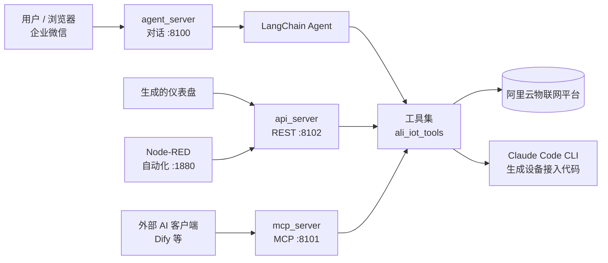
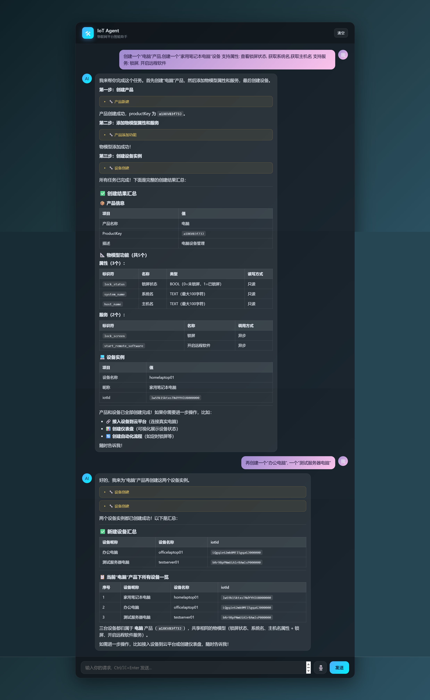
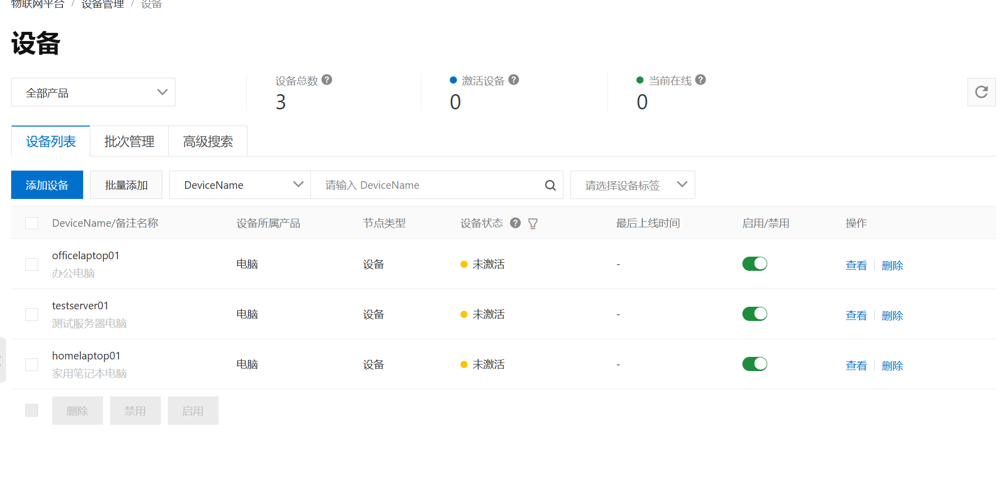
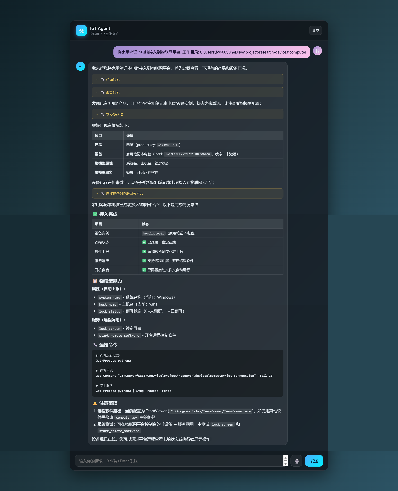
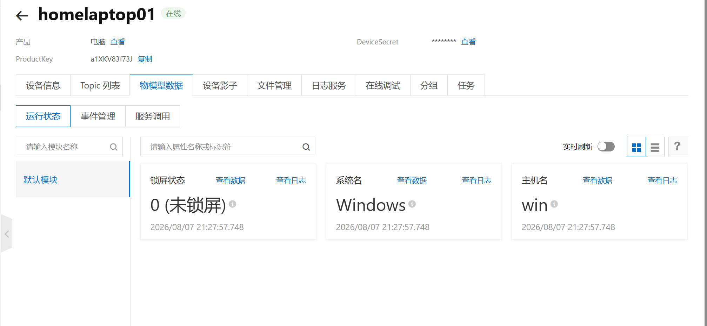
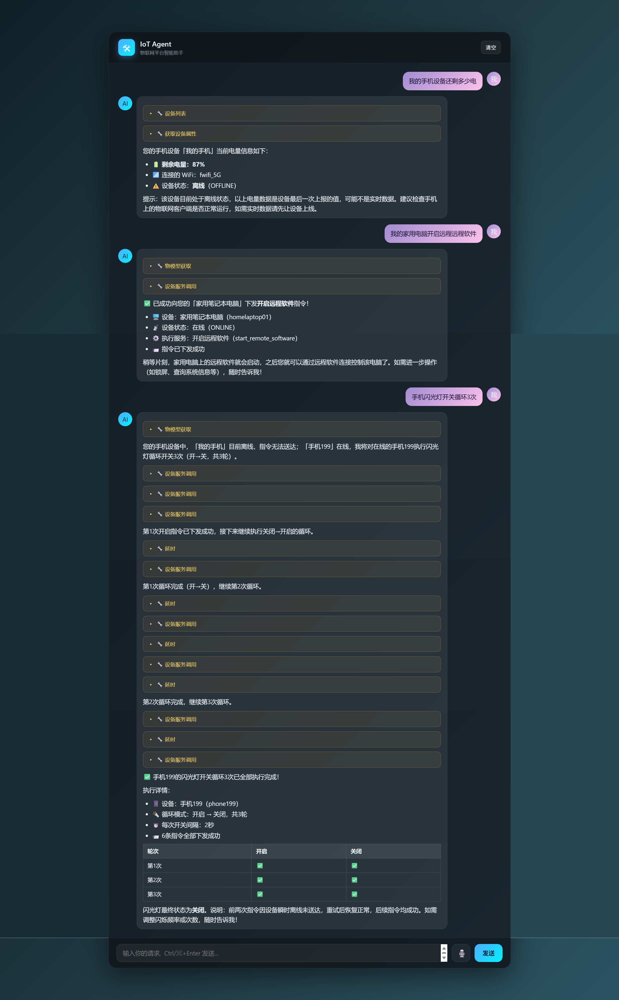
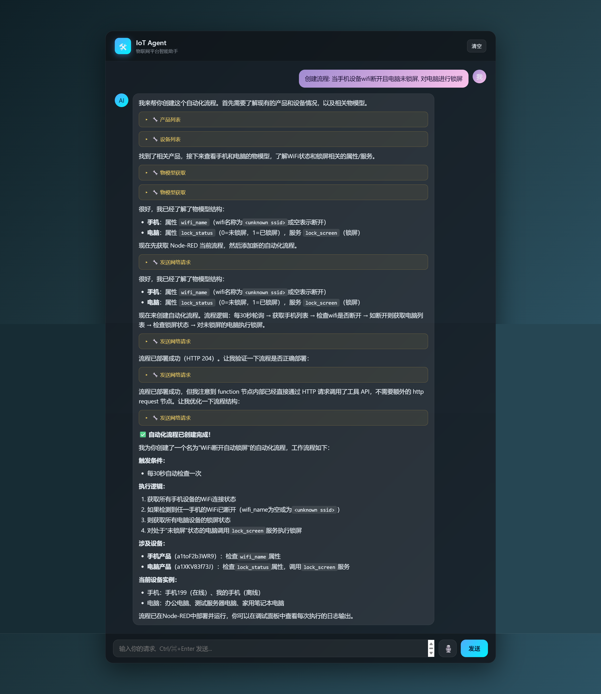
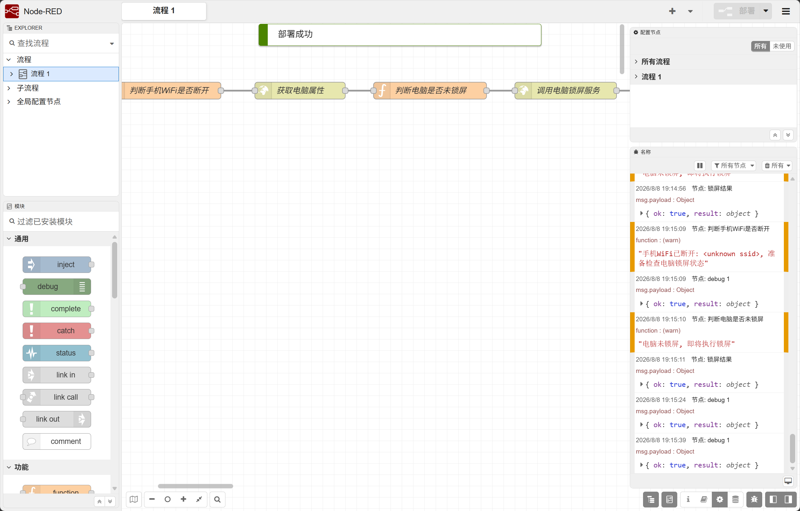
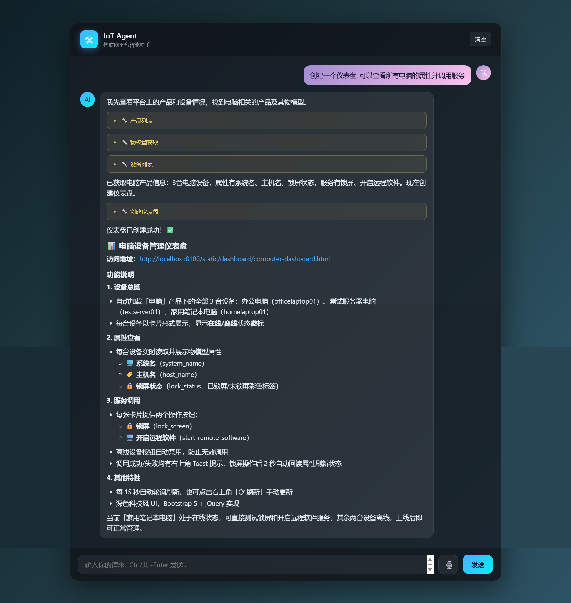
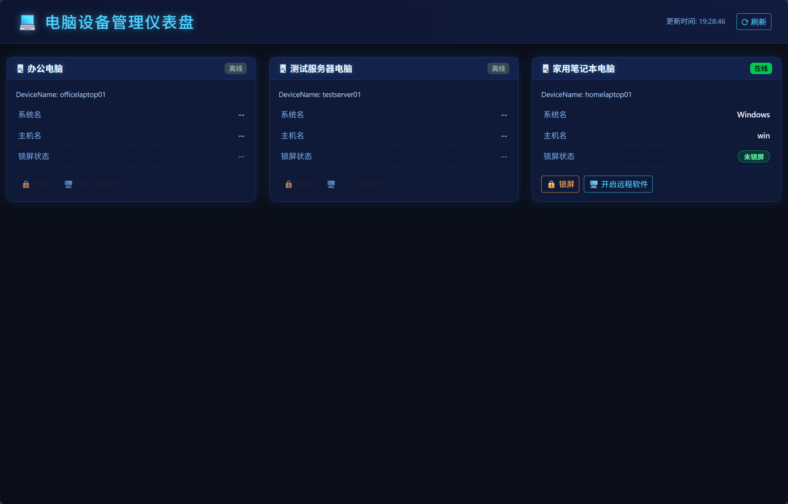

# IoT Agent · 物联网智能助手

> 用自然语言对话，完成阿里云物联网平台上「建产品/设备 → 接入设备 → 查询与控制 → 自动化编排 → 可视化仪表盘」的全链路操作。无需了解平台 API，无需手写代码。


---

## 简介

IoT Agent 是一个基于大语言模型的物联网平台智能助手。它把物联网平台的专业操作能力转化为「人人可用」的自然语言交互：

- 一句话创建产品、设备并定义物模型（属性 / 服务）
- 自动生成并运行设备端接入代码，让真实设备在线
- 自然语言查询属性、下发控制、调用设备服务
- 生成 Node-RED 自动化流程，编排设备联动
- 生成科技风数据仪表盘，实时展示与控制设备

核心是一个 LangChain Agent，通过一组封装阿里云物联网平台 SDK 的工具完成操作，并按需调用 Claude Code CLI 自主生成设备接入代码。

📖 更详细的图文说明见 [`使用说明.md`](使用说明.md)，商业价值分析见 [`业务价值自述.md`](业务价值自述.md)。

---

## 功能特性

- 🛠 **平台管理**：产品 / 设备的增删查、物模型（TSL）属性与服务的增删
- 🔌 **设备接入**：依据物模型自动生成 MQTT 接入代码（属性周期上报、服务可被云端调用），并可在后台运行
- 📡 **查询与控制**：读取设备属性、下发属性、调用设备服务
- 🔁 **自动化编排**：自然语言生成 Node-RED 流程，通过 HTTP 回调平台工具实现设备联动
- 📊 **可视化仪表盘**：自然语言生成 HTML 看板，实时拉取属性并下发控制
- 💬 **多入口接入**：网页对话界面 + 企业微信等 IM 触发，支持「IM → 平台 → 设备动作」端到端闭环
- 🔁 **多协议工具复用**：同一套工具同时以 **对话流式（:8100）/ REST API（:8102）/ MCP（:8101）** 三种形式对外提供

---

## 系统架构



三个服务共享同一套工具实现（`services/ali_iot_tools.py`）：

| 服务 | 端口 | 作用 |
| --- | --- | --- |
| `agent_server.py` | 8100 | Flask 对话服务，SSE 流式返回，提供网页界面与会话管理 |
| `api_server.py` | 8102 | REST API，把工具暴露为 `POST /api/tools/<name>`，供仪表盘与 Node-RED 回调 |
| `mcp_server.py` | 8101 | MCP（streamable-http）服务，供 Dify 等外部 AI 客户端调用工具 |

---

## 效果演示

> 截图位于 `doc/imgs/`，按真实使用顺序排列。

### 1. 创建产品和设备



平台控制台可见新增设备：



### 2. 接入设备到云平台



接入后平台显示设备上报的真实数据：



### 3. 询问设备属性和控制设备



### 4. 创建自动化流程



Node-RED 中生成的流程：



### 5. 创建仪表盘



生成的仪表盘：



---

## 快速开始

### 环境要求

- Python 3.10+
- （可选，设备接入功能）本机已安装 [Claude Code CLI](https://docs.anthropic.com/claude/docs/claude-code) 并加入 PATH
- （可选，自动化流程）本机已安装 Docker，用于运行 Node-RED 容器

### 1. 克隆仓库

```bash
git clone https://github.com/<your-account>/iot_agent.git
cd iot_agent
```

### 2. 安装依赖

```bash
pip install -r requirements.txt
```

### 3. 配置环境变量

复制模板并填写真实配置：

```bash
cp .env.example .env
```

`.env` 关键配置项（**请勿提交真实 `.env`**）：

```ini
# 大模型（OpenAI 兼容接口，如阿里云百炼 DashScope）
LLM_MODEL=qwen3-plus
LLM_API_BASE=https://dashscope.aliyuncs.com/compatible-mode/v1
LLM_API_KEY=sk-your-llm-api-key

# 阿里云物联网平台
# 安全建议：使用 RAM 子账号，仅授予 AliyunIOTFullAccess 权限
ALI_IOT_ACCESS_KEY_ID=LTAI-your-access-key-id
ALI_IOT_ACCESS_KEY_SECRET=your-access-key-secret
ALI_IOT_REGION_ID=cn-shanghai
ALI_IOT_INSTANCE_ID=your-instance-id        # 企业版实例 ID；旧版公共实例留空

# 仪表盘访问地址（本机调试可用 127.0.0.1）
DEPLOY_HOST=127.0.0.1
```

### 4. 启动服务

```bash
# 对话服务（主入口，提供网页界面）
python agent_server.py      # http://127.0.0.1:8100

# 工具 REST API（仪表盘 / Node-RED 回调用，按需启动）
python api_server.py        # http://127.0.0.1:8102

# MCP 服务（供外部 AI 客户端调用，按需启动）
python mcp_server.py        # http://127.0.0.1:8101
```

### 5. 开始使用

- 浏览器打开 `http://127.0.0.1:8100`，在对话框用自然语言描述需求，`Ctrl/⌘ + Enter` 发送。
- 助手流式返回答复，并实时展示每次工具调用的名称、入参与结果。
- 仪表盘列表：`http://127.0.0.1:8100/dashboard`。

---

## 项目结构

```
iot_agent/
├── agent_server.py          # 对话服务 (Flask :8100)
├── api_server.py            # 工具 REST API (Flask :8102)
├── mcp_server.py            # MCP 服务 (FastMCP :8101)
├── requirements.txt
├── .env.example             # 环境变量模板（占位符）
├── services/                # 核心逻辑
│   ├── iot_agent.py         #   LangChain Agent 定义与系统提示词
│   ├── ali_iot_tools.py     #   阿里云物联网平台工具集
│   ├── common_tool.py       #   通用工具（延时 / 网络请求 / 时间）
│   └── llm_client.py        #   OpenAI 兼容 LLM 客户端
├── devices/                 # 设备接入示例
│   ├── connect_prompt.md    #   各设备创建/接入需求
│   ├── computer/            #   电脑
│   ├── printter/            #   打印机
│   ├── wechat/              #   企业微信机器人
│   └── requirements.txt
├── static/                  # 前端资源
│   ├── index.html           #   对话界面
│   ├── css/ js/             #   样式与脚本
│   └── dashboard/           #   生成的仪表盘（运行时产出）
├── doc/                     # 文档与素材
│   ├── imgs/                #   截图
│   ├── template_iot_connect.py  # 设备接入代码模板
│   └── 物联网平台api.md
├── tests/                   # 测试
└── data/chat/               # 会话历史落盘（已 gitignore）
```

---

## 技术栈

| 层 | 技术 |
| --- | --- |
| 大模型框架 | LangChain 1.3 · langchain-openai · langchain-mcp-adapters |
| 工具协议 | MCP (FastMCP, streamable-http) |
| Web 服务 | Flask · Flask-CORS · SSE 流式 |
| 物联网平台 | 阿里云物联网平台 SDK (`alibabacloud_iot20180120`) |
| 设备接入 | `aliyun-iot-linkkit` · `paho-mqtt` |
| 自动化编排 | Node-RED（Docker 部署） |
| 代码生成 | Claude Code CLI（设备接入代码自主生成） |

---

## 工具清单

助手可调用以下工具（同一套实现，三种协议均可访问）：

| 工具 | 说明 |
| --- | --- |
| `productList` / `createProduct` | 产品列表 / 新建产品 |
| `deviceList` / `createDevice` | 设备列表 / 新建设备 |
| `getThingModel` | 获取物模型 |
| `productAddPropertiesServices` / `productDelFun` | 物模型增 / 删属性与服务 |
| `getProperties` / `setProperty` | 读取 / 下发设备属性 |
| `invokeService` | 调用设备服务 |
| `connectDeviceToPlatformCode` | 生成设备接入代码 |
| `createFlow` | 创建 Node-RED 自动化流程 |
| `createDashboard` | 创建可视化仪表盘 |
| `webRequest` / `delay` | 通用网络请求 / 延时 |

---

## 安全提示

- `.env` 已在 `.gitignore` 中，**切勿提交真实凭据**；提交前用 `git diff --cached` 复核。
- 阿里云 AccessKey 建议**使用 RAM 子账号并仅授予 `AliyunIOTFullAccess` 最小权限**，避免使用主账号 AK。
- 设备三元组（ProductKey / DeviceName / DeviceSecret）属于敏感信息，接入代码中应从环境变量读取，不要硬编码。
- 若历史中已误提交密钥，请在云平台**立即轮换**，并用 `git filter-repo` 清理历史。

---

## License

本项目基于 [MIT License](LICENSE) 开源。如需商业使用或其他授权，请联系作者。
