# 一句话,点亮一台设备:IoT Agent 让物联网平台「开口说人话」

> 「帮我在物联网平台上建一个打印机产品,把这台打印机接上去,再让它在每周四下午提醒大家交周报。」——如果你以为这需要翻半天 API 文档、写几百行代码,那你还没见过 IoT Agent。


---

## 痛点:物联网平台很强,但门槛也很高

物联网平台的能力早已齐备:物模型、设备接入、规则引擎、数据可视化……但对大多数人来说,用好它仍然意味着:

- **建产品、建设备、定义物模型**,要在控制台里层层点选,属性、服务一项项配置;
- **接入一台真实设备**,需要理解三元组、MQTT 主题、物模型 JSON,再写一段设备端代码;
- **查个属性、下个指令**,得先弄清平台 API 的鉴权、参数和返回结构;
- **想要联动和看板**,还得再学一套规则引擎或前端开发。

这些门槛把「能用」和「好用」隔开了一整支开发团队的距离。**IoT Agent 要做的,就是把这段距离压缩成一句话。**

## IoT Agent 是什么

IoT Agent 是一个基于大语言模型的物联网平台智能助手。它以阿里云物联网平台为底座,用 LangChain Agent 封装了一整套平台操作工具,让你通过自然语言对话,就能走完物联网业务的**全链路**:

**建产品/设备 → 接入设备 → 查询与控制 → 自动化编排 → 可视化仪表盘**

无需了解平台 API,无需手写一行代码。

## 五步走完全链路,每步都只是一句话

### 第 1 步 · 创建产品和设备

「帮我创建一个打印机产品和设备,带打印和状态两个功能。」助手会先核对是否已有同名产品,再依次完成建产品、建设备、定义物模型属性与服务——控制台上立刻可见新增设备。

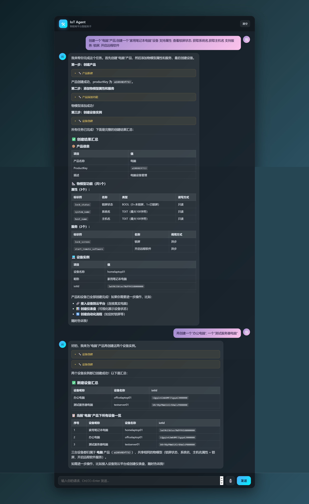

### 第 2 步 · 接入设备

告诉助手把某台设备接入平台,它会依据设备三元组与物模型,**自动生成并运行设备端 MQTT 接入代码**:属性按物模型周期上报,服务可被云端调用。几句话之后,设备真实在线,平台开始收到数据。

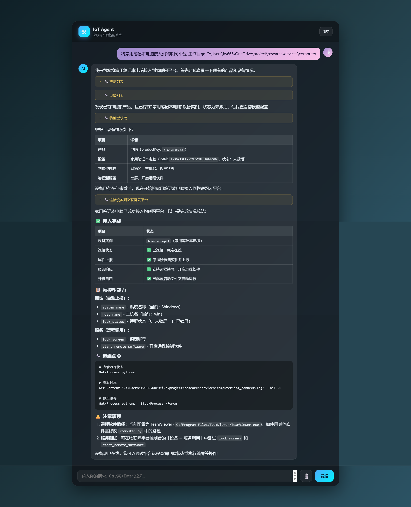

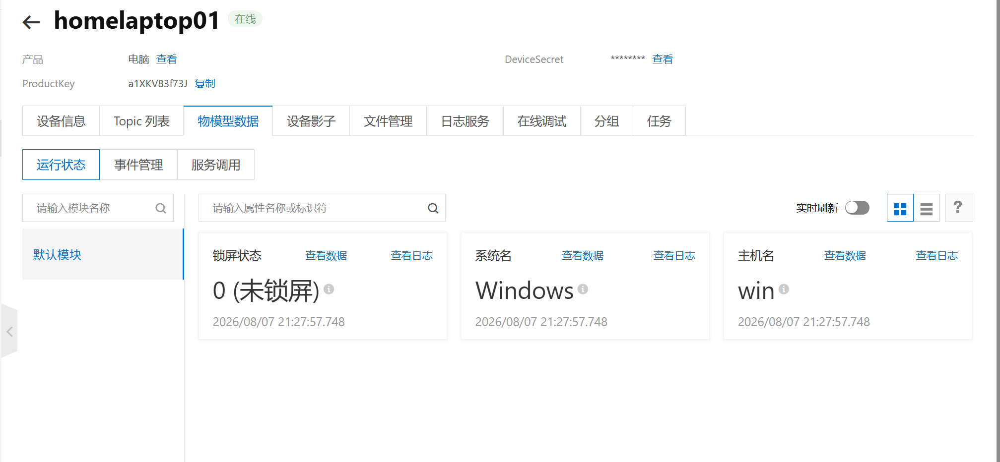

### 第 3 步 · 查询与控制

「打印机现在什么状态?」「让它打印这份文件。」属性读取、属性下发、服务调用,全部通过对话完成。

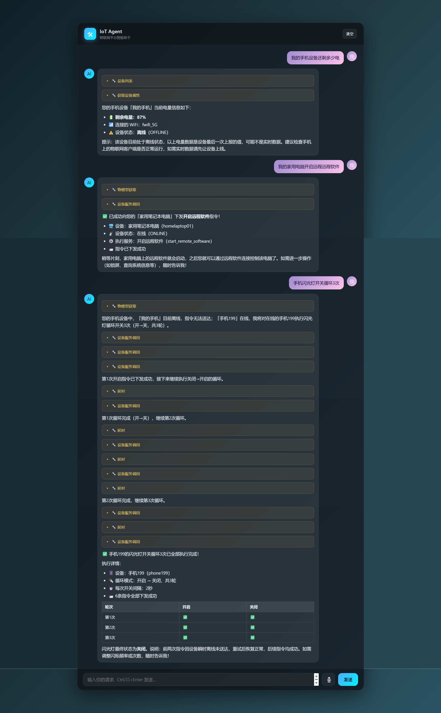

### 第 4 步 · 自动化编排

用自然语言描述联动规则,助手生成 **Node-RED 自动化流程**并即时生效——「每周四下午让机器人在群里提醒交周报」「员工离开工位自动锁屏」,这类办公自动化一句话就能落地。

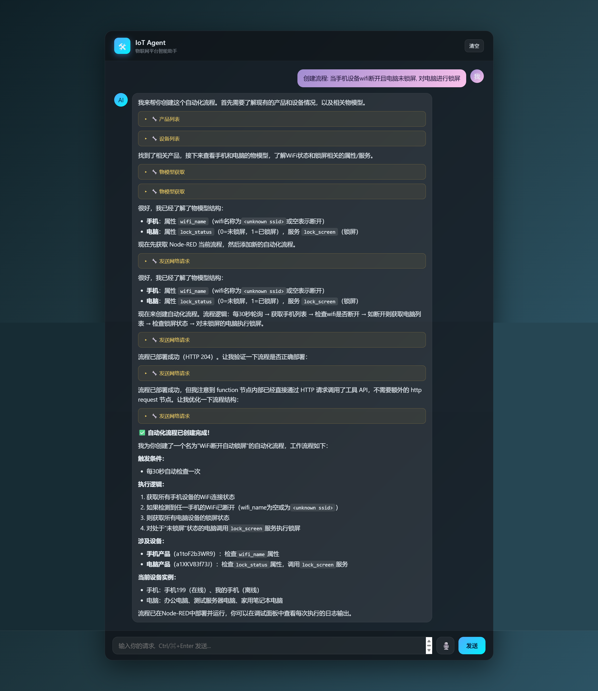

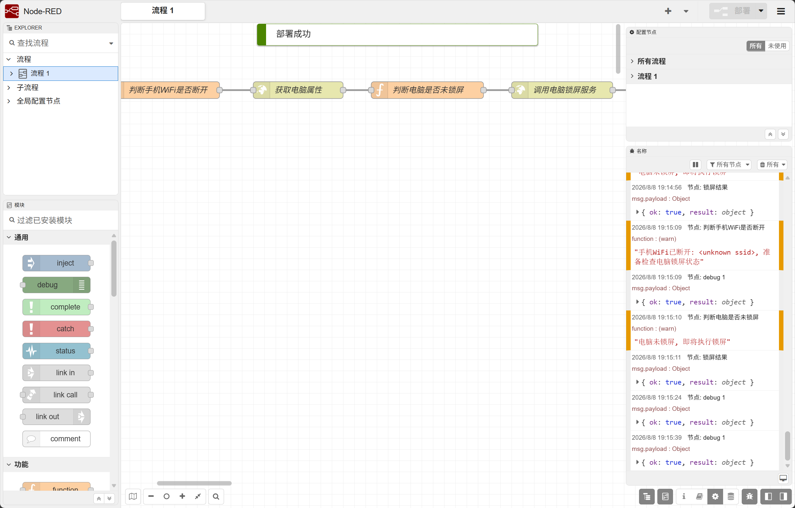

### 第 5 步 · 可视化仪表盘

「给我做一个打印机监控大屏。」助手生成科技风 HTML 仪表盘,实时拉取设备属性、支持直接下发控制,在仪表盘列表中即可访问。

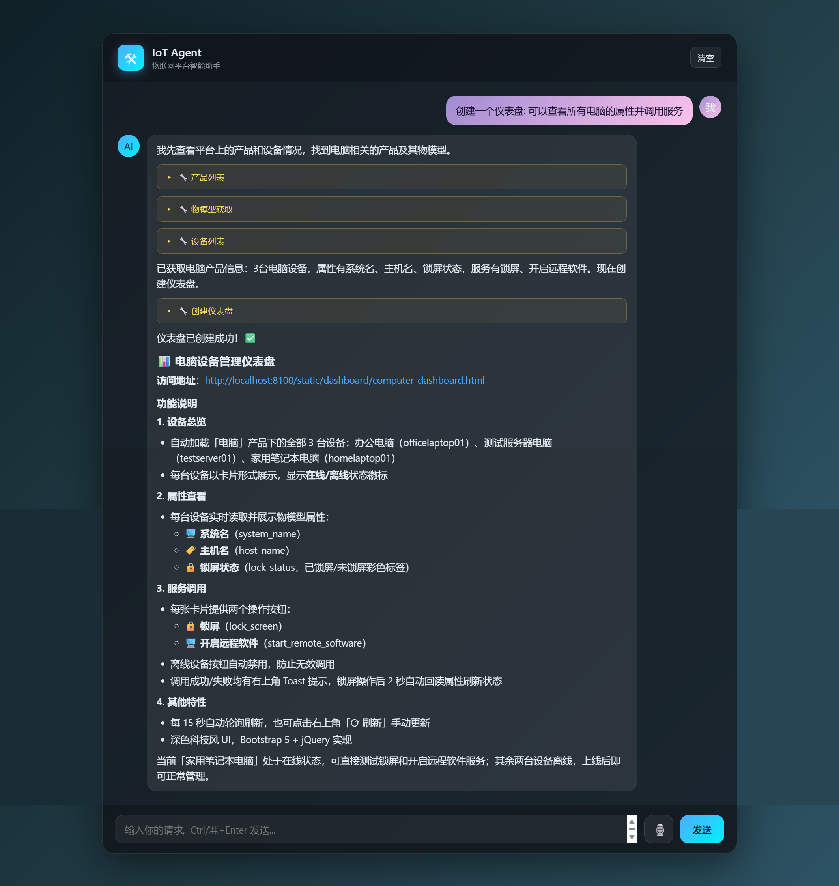

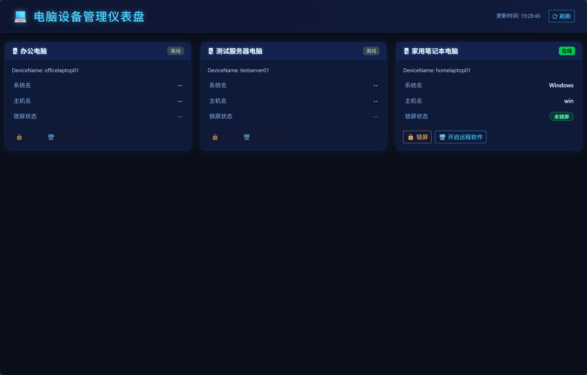

## 端到端闭环:在企业微信里说一句话,打印机就动了

最能体现价值的场景是这条完整链路:

**企业微信对话 → 物联网平台 → 打印机服务 → 本机 PDF 打印**

员工在 IM 里发一句「打印这个文件」,指令经平台调用「打印机」设备的服务,真实打印机随即开始工作——不登录任何系统,不打开任何控制台。

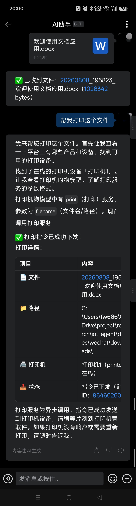

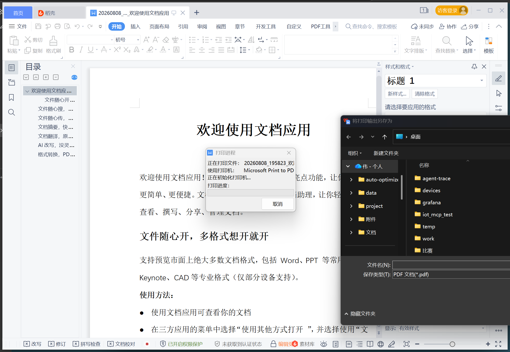

## 架构:一套工具,三种协议,多处复用

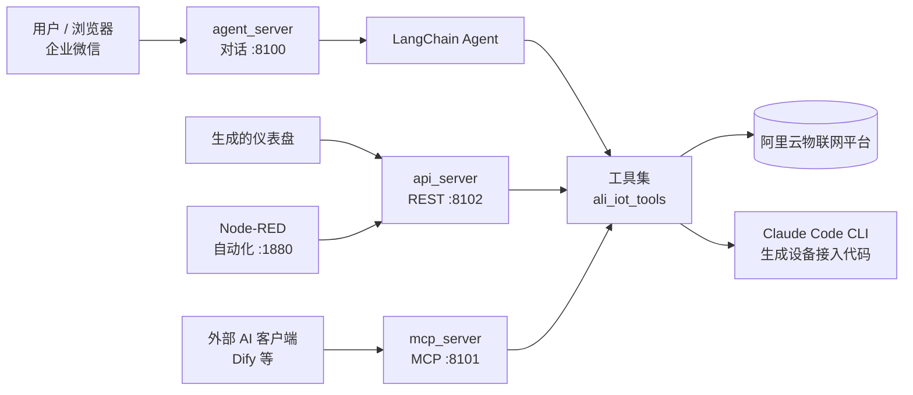

几个值得一提的设计:

- **一套工具三种出口**:同一套阿里云平台工具(`services/ali_iot_tools.py`),同时以**对话流式(:8100)/ REST API(:8102)/ MCP(:8101)**三种形式对外提供。网页对话、仪表盘回调、Node-RED 联动、Dify 等外部 AI 客户端,用的是同一份实现,不重复造轮子。
- **Agent + 工具调用**:核心是一个 LangChain Agent,按需调用 `createProduct`、`setProperty`、`invokeService` 等十余个平台工具,每次调用的名称、入参、结果都在网页上实时可见——AI 做了什么,一目了然。
- **AI 生成 AI 的代码**:设备接入代码由 Claude Code CLI 依据物模型自主生成,新增一种设备,不需要人工维护接入模板。
- **SSE 流式体验**:Flask + SSE 让助手的回答逐字呈现,长任务不再对着空白页面干等。

## 谁适合用它

| 用户 | 价值 |
| --- | --- |
| 物联网平台运营/运维人员 | 不写代码、不查 API 文档,一句话完成设备开通、指令下发、流程编排、大屏开发 |
| 应用集成开发者 | 仪表盘与自动化流程由助手生成,直接在业务系统中复用;MCP 协议随时接入 Dify 等平台 |
| 非技术终端用户 | 在企业微信等 IM 中自然对话即可触发设备动作,零学习成本 |

办公自动化、智能制造、监控运维、智慧家居——只要设备能接入平台,IoT Agent 就能把专业操作翻译成「人话」。

## 快速上手

```bash
git clone https://github.com/<your-account>/iot_agent.git
cd iot_agent
pip install -r requirements.txt
cp .env.example .env   # 填入 LLM 与阿里云平台配置

python agent_server.py # 打开 http://127.0.0.1:8100,开始对话
```

> 安全提示:阿里云 AccessKey 建议使用 RAM 子账号并仅授予 `AliyunIOTFullAccess` 最小权限;`.env` 已在 `.gitignore` 中,切勿提交真实凭据。

## 写在最后

物联网的终点不是「设备上线」,而是「人人都能指挥设备」。IoT Agent 用大模型抹平了平台能力与普通使用者之间的鸿沟——**让会用微信的人,就能用物联网。**

项目基于 MIT 协议开源,欢迎 Star、Fork、提 Issue,也欢迎带着你的设备场景来一起折腾。

---

🔗 更多图文说明见 [`使用说明.md`](使用说明.md),项目详情见 [`README.md`](../README.md)。
